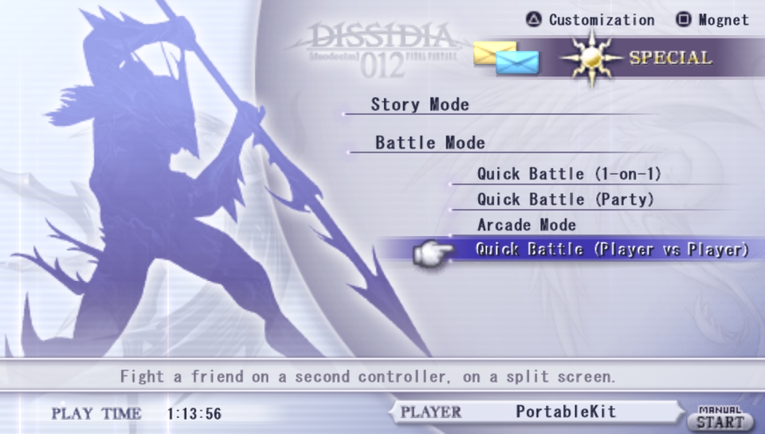
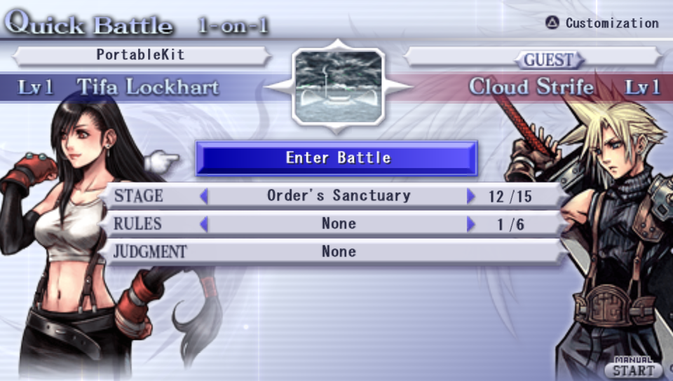
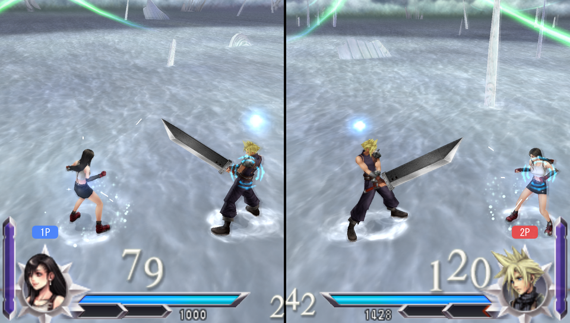

# Dissidia 012 Duodecim Final Fantasy: native PC port and decompilation

A native PC port of *Dissidia 012 Duodecim Final Fantasy* (PSP, USA release ULUS10566 v1.00), built by static
recompilation on [PortableKit](https://github.com/TeamGDB/PortableKit), together with a matching decompilation of the
game's executable and overlays.

- **The port** (`port/`) recompiles the game's MIPS code to C++ and runs it on PortableKit's re-implemented PSP
  kernel, system modules and Vulkan renderer. Decompiled C replaces recompiled functions where an enhancement needs
  it.
- **The matching decompilation** (`src/`, `include/`, `config/`, `tools/`) rebuilds the decrypted executable and all
  three overlays byte for byte with the original compilers, and is the reference for what the original code does.

**You need your own legally obtained copy of the game (USA ULUS10566); no game data is included or distributed.**

## Current state

- **Windows:** plays from New Game through the menus and battles in the recompiled build, with no interpreter
  fallbacks. Message, save-data and keyboard dialogs are drawn by the port. Expect rough edges; see the
  [bring-up log](docs/port/bring-up-log.md).
- **Steam Deck:** plays through Proton as a non-Steam game, built on a Windows PC (`setup.ps1 -Deck`; see
  [docs/port/steam-deck.md](docs/port/steam-deck.md)).
- **Linux (native):** untested. PortableKit supports it, but this port has not been built natively there yet.
- **Matching decompilation:** a few hundred functions are matching C; most of the game is still machine code. See the
  [decompilation notes](docs/decomp/README.md) and the [progress report](docs/decomp/progress.md).

## Features

- **60 fps** display by frame interpolation over the game's 30 Hz logic.
- **Higher internal resolution.**
- **A right-stick camera** in battle and on the world map; R3 recentres ([notes](docs/port/right-stick-camera.md)).
- **True analog movement** on the world map instead of the original's 8 directions, and full diagonals from a
  modern stick ([notes](docs/port/analog-movement.md)).
- **A mod folder** for content that adds to the game and never replaces it; the first kind is battle music in MP3,
  Ogg Vorbis, Opus, FLAC, WAV, or BRSTM/BCSTM/BFSTM with their own loops ([format](docs/port/mod-folder.md)).
- **A BGM playlist selector** on the loading screen: choose music by series and track, mod tracks included
  ([design](docs/port/bgm-playlist-design.md)).
- **A Battle BGM Maker**: a local browser tool for writing a mod's `mod.json` and setting its loop points
  ([README](port/tools/bgm_maker/README.md)).
- **Local split-screen versus**: two players on one PC, each with their own controller and camera
  ([notes](docs/port/local-versus.md)).

## BGM playlist selector

The loading screen before a battle chooses its music by series and track. L2 or R2 (1 and 3 on the keyboard) moves
the D-pad from the screen's menu to the music: left and right change the series, up and down roll the track wheel,
and L2 or R2 again hands the D-pad back. Mods add series of their own after the game's
([design](docs/port/bgm-playlist-design.md), [mod format](docs/port/mod-folder.md)).

<p>
  
  
</p>

*Rolling through a series' tracks (up/down):*


*Switching series (left/right):*


The FINAL FANTASY XV and CRISIS CORE series in these captures come from a test mod with track titles only; it plays
generated tones.

## Local split-screen versus

Battle Mode has a new row, **Quick Battle (Player vs Player)**: a 1-on-1 between two players on one PC, the second
on a second controller. Player 2 picks the opponent with their own controller, and the battle setup drops the CPU's
rows. In battle the screen is split down the middle, each half from its player's own camera and at 60 fps, with the
game's HUD across both. EX Bursts and the finishing blow play full screen. A versus battle gives no rewards. Either player can pause, and a controller that goes away pauses the battle until it
comes back ([notes](docs/port/local-versus.md)).

<p>
  
  
</p>



`D012_LOCAL_VERSUS=0` leaves the game as it was, without the row.

## Quick start (Windows)

The port is built on your PC from this repository and your own copy of the game. One script does it all. A
download that needs no build tools is planned.

**1. Install these** (free; the defaults are fine unless noted):

- [Visual Studio 2022 Community](https://visualstudio.microsoft.com/downloads/) with the workload
  **Desktop development with C++** (or Build Tools 2022 with the same workload).
- [Python](https://www.python.org/downloads/windows/) 3.10 or newer. Tick "Add python.exe to PATH".
- [Git for Windows](https://git-scm.com/download/win).
- An up-to-date graphics driver (Vulkan support: any GPU from about 2016 on).
- About 5 GB of free disk space.

**2. Have your game ready:** your own USA ISO (**ULUS10566**), as an `.iso` file.

**3. Run the setup** in PowerShell:

```powershell
git clone https://github.com/VCKing101/Dissidia012-pc.git
cd Dissidia012-pc
powershell -ExecutionPolicy Bypass -File .\setup.ps1
```

(Or double-click `setup.cmd`.) It checks what is installed, downloads and verifies the dependencies, asks for your
ISO, checks it, and builds the port. The first time takes about 10 to 30 minutes, most of it compiling.

**4. Play** with the new "Dissidia 012 (PC port)" shortcut on the desktop or in the Start menu. Esc, or L3 + R3 on a
controller, opens the port's menu. Your saves are in `build/port/data/ms0`, and mods go in `build/port/data/mods`.

**To update:** `git pull`, then run `setup.ps1` again. It rebuilds only what changed.

Options, what each step does, and troubleshooting: [docs/port/setup.md](docs/port/setup.md). The manual build steps
for developers are in [`port/README.md`](port/README.md). For the Steam Deck, see
[docs/port/steam-deck.md](docs/port/steam-deck.md) (`setup.ps1 -Deck` builds its package).

The matching decompilation has its own toolchain (the historical PSP SNC compiler, a WSL build environment, splat,
spimdisasm and Ghidra with the Allegrex extension); see [getting started](docs/decomp/getting-started.md).

## Repository layout

| Path | What it is |
| --- | --- |
| `port/` | The port: PortableKit profile and host code, decompiled C used as native overrides, PortableKit patches, example mod, Battle BGM Maker |
| `docs/port/` | Port research, bring-up log, recompiled build, mod folder and BGM playlist design |
| `tools/port/` | Port scripts: build wrapper, game-directory preparation, bounded runs, overlay metadata, surveys |
| `src/`, `include/` | Matching decompiled C/C++ for main and the menu, battle and extra overlays |
| `config/` | Build, linker, inventory and audit configuration for the matching builds |
| `tools/` | Build, verify, inventory, audit and analysis tools for the matching decompilation, and their tests |
| `docs/decomp/` | Matching-decompilation notes, milestones, audits and runtime validation |
| `docs/research/` | General research on the game's formats and systems (battle camera, movesets, pad module, roster and save) |

Ignored and never committed: the game image, everything extracted or built from it (`build/`, `orig/`, `asm/`,
`analysis/`, `assets/`), local toolchains and clones (`tools/local/`, `tools/compilers/`), and mods with music.

## Tests

```powershell
.\.venv\Scripts\python.exe -m unittest discover -s tools -p "test_*.py"
python -m unittest discover -s port/tools/bgm_maker/tests
```

Many tool tests need the locally extracted game files and skip or fail without them.

## Credits

- [PortableKit](https://github.com/TeamGDB/PortableKit) by TeamGDB (MIT): the recompiler, runtime, HLE and renderer
  the port is built on, with its bundled libraries (Dear ImGui, stb, xxHash, tiny-AES).
- [FFmpeg](https://ffmpeg.org/) (LGPL), as built by PortableKit, for movie and host audio decoding.
- [SDL3](https://libsdl.org/) (zlib licence), [glslang](https://github.com/KhronosGroup/glslang) (BSD-style) and
  the [Vulkan headers](https://github.com/KhronosGroup/Vulkan-Headers) (Apache 2.0 or MIT).
- PPSSPP was used as a behaviour reference only; none of its code is in this repository.

## Licence and disclaimer

Original code and documentation are under the [MIT licence](LICENSE). See [NOTICE.md](NOTICE.md) for what it does and
does not cover.

This project is not affiliated with or endorsed by Square Enix or Sony. *Dissidia*, *Final Fantasy*, PlayStation
Portable and all related names are trademarks of their respective owners.
