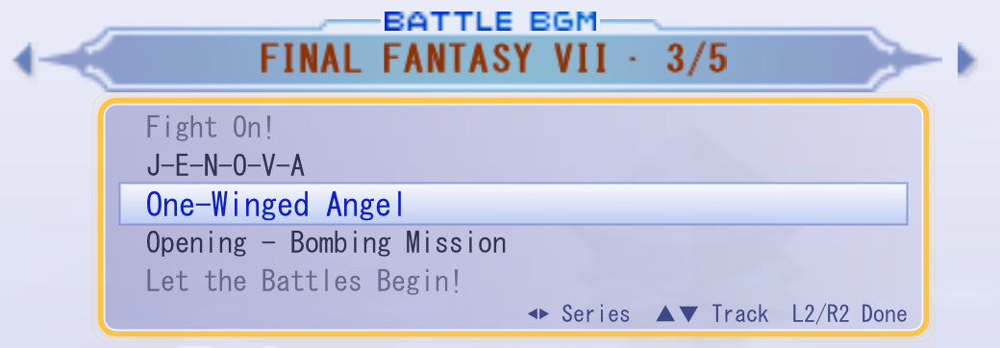
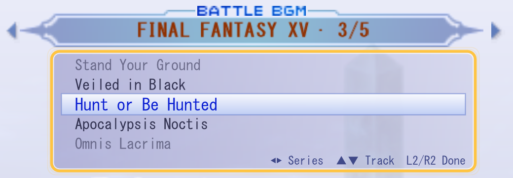
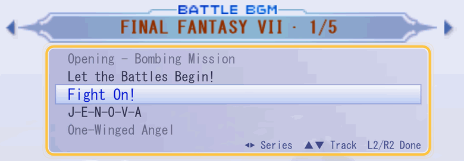
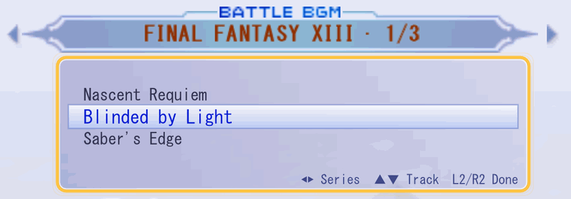
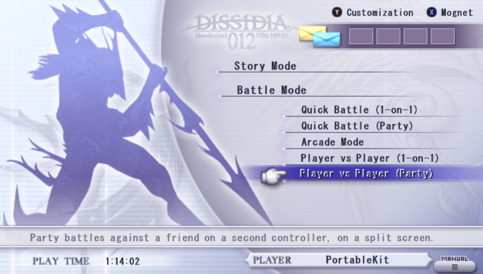
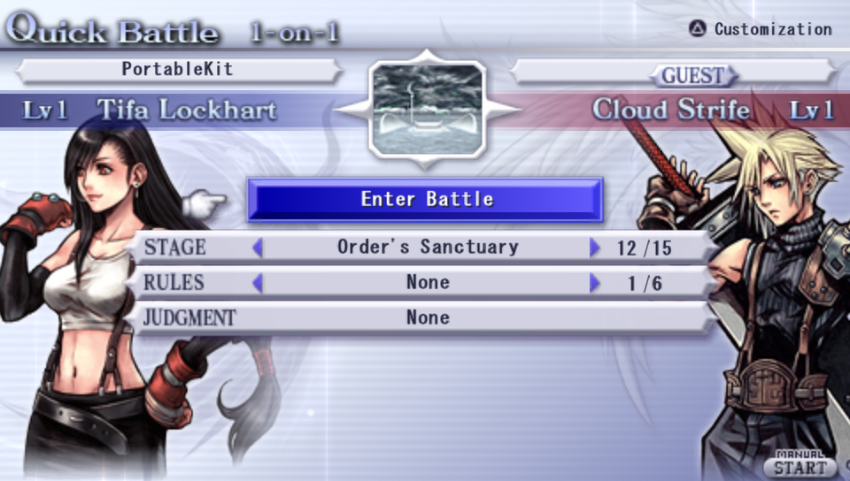
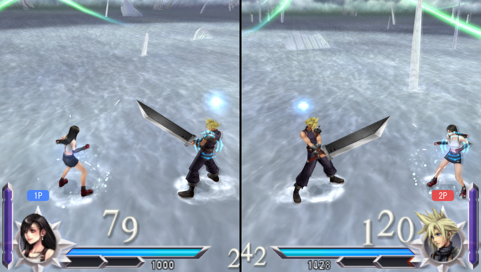
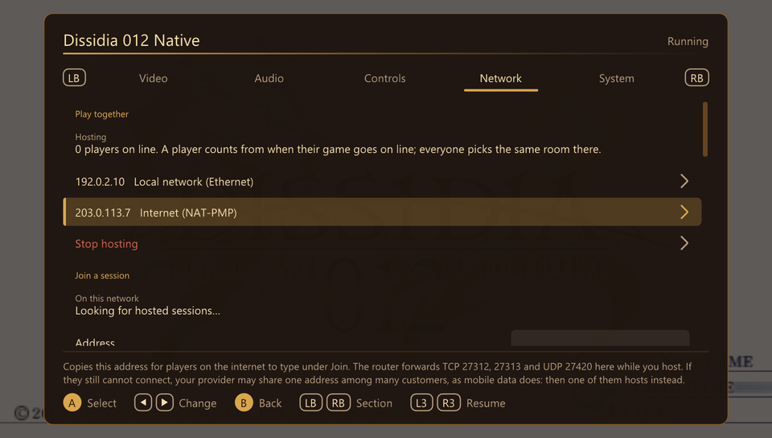

# Dissidia 012 Duodecim Final Fantasy: native PC port and decompilation

A native PC port of *Dissidia 012 Duodecim Final Fantasy* (PSP, USA release ULUS10566 v1.00), built by static
recompilation on [PortableKit](https://github.com/TeamGDB/PortableKit), together with a matching decompilation of the
game's executable and overlays.

- **The port** (`port/`) recompiles the game's MIPS code to C++ and runs it on PortableKit's re-implemented PSP
  kernel, system modules and Vulkan renderer. Decompiled C replaces recompiled functions where an enhancement needs
  it.
- **The matching decompilation** (`src/`, `include/`, `config/`, `tools/`) rebuilds the decrypted executable and all
  three overlays byte for byte with the original compilers, and is the reference for what the original code does.

**You need your own legally obtained copy of the game (USA ULUS10566); no game data is included or distributed.**

## Current state

- **Windows:** plays from New Game through the menus and battles in the recompiled build, with no interpreter
  fallbacks. Message, save-data and keyboard dialogs are drawn by the port. Expect rough edges; see the
  [bring-up log](docs/port/bring-up-log.md).
- **Steam Deck:** plays through Proton as a non-Steam game, built on a Windows PC (`setup.ps1 -Deck`; see
  [docs/port/steam-deck.md](docs/port/steam-deck.md)). The Windows setup has not been tried on the Deck.
- **Linux (native):** untested. PortableKit supports it, but this port has not been built natively there yet.
- **Matching decompilation:** a few hundred functions are matching C; most of the game is still machine code. See the
  [decompilation notes](docs/decomp/README.md) and the [progress report](docs/decomp/progress.md).

## Features

- **60 fps** display by frame interpolation over the game's 30 Hz logic.
- **Higher internal resolution.**
- **A right-stick camera** in battle and on the world map; R3 recentres ([notes](docs/port/right-stick-camera.md)).
- **True analog movement** on the world map instead of the original's 8 directions, and full diagonals from a
  modern stick ([notes](docs/port/analog-movement.md)).
- **A mod folder** for content that adds to the game and never replaces it; the first kind is battle music in MP3,
  Ogg Vorbis, Opus, FLAC, WAV, or BRSTM/BCSTM/BFSTM with their own loops ([format](docs/port/mod-folder.md)).
- **A BGM playlist selector** on the loading screen: choose music by series and track, mod tracks included
  ([design](docs/port/bgm-playlist-design.md)).
- **A Battle BGM Maker**: a program for making music mods, with a loop editor, loop suggestions and a button to try
  a track in the game; optionally it also makes a copy of your ISO with the mods' tracks added, for PPSSPP or a PSP
  ([guide](docs/port/mod-folder.md#8-making-a-mod-with-the-battle-bgm-maker)).
- **Local split-screen versus**: two players on one PC, each with their own controller and camera
  ([notes](docs/port/local-versus.md)).
- **HD texture packs** in PPSSPP's format, and a menu option that dumps the game's textures to start one
  ([below](#hd-texture-packs)).
- **Online versus (experimental)**: 1-on-1 battles over the internet through the game's own Communication Mode, with
  full analog and each player's right-stick camera ([guide](docs/port/play-online.md)).

## BGM playlist selector

The loading screen before a battle chooses its music by series and track. L2 or R2 (1 and 3 on the keyboard) moves
the D-pad from the screen's menu to the music: left and right change the series, up and down roll the track wheel,
and L2 or R2 again hands the D-pad back. Mods add series of their own after the game's
([design](docs/port/bgm-playlist-design.md), [mod format](docs/port/mod-folder.md)).

<p>
  
  
</p>

*Rolling through a series' tracks (up/down):*



*Switching series (left/right):*



The FINAL FANTASY XV and CRISIS CORE series in these captures come from a test mod with track titles only; it plays
generated tones.

## Local split-screen versus

Battle Mode has a new row, **Quick Battle (Player vs Player)**: a 1-on-1 between two players on one PC, the second
on a second controller. Player 2 picks the opponent with their own controller, from player 1's roster, and fights with
player 1's saved build for that character (level, equipment, abilities, look and set); the battle setup drops the
CPU's rows. In battle the screen is split down the middle, each half from its player's own camera and at 60 fps, with
the game's HUD across both and each player's own command prompts. Chases stay split; EX Bursts and the victory play
full screen. A versus battle gives no rewards and leaves no records in the save. Either player can pause, and a
controller that goes away pauses the battle until it comes back ([notes](docs/port/local-versus.md)).

<p>
  
  
</p>



Each player's camera keeps both fighters inside their own half of the screen. To see more around them, raise
**Split-screen field of view** at the end of the menu's Video page (100% is the game's own view, up to 150%); it
is kept as `game.versus_fov` in `settings.ini`.

`game.local_versus=0` in `settings.ini` (in the data folder, next to your saves' `ms0`) leaves the game as it was,
without the row; set it back to `1` to bring it back. `D012_LOCAL_VERSUS=0` does the same for one run.

## Online play (experimental)

Two players fight a 1-on-1 battle over the internet in the game's own **Communications Mode**, each on their own PC
or Steam Deck. The battle runs on the port's own netcode: full analog, each player's right-stick camera and an input
delay set from the connection.

1. **Host:** open the menu (Esc, or L3 + R3), go to the **Network** page and choose **Host a session**. The game
   asks your router to open its ports and shows your internet address; select it to copy it, and send it to the
   other player.
2. **Join:** on the **Network** page, type the host's address under **Join a session**.
3. Both go to **Communications Mode**, into the same **Online Lobby**, and one challenges the other.

Step by step, with pictures of each screen: the [players' guide](docs/port/play-online.md).



Both players need the same release and the same mods that change the game; the game checks and says what differs.
When the router cannot open its ports, or your provider shares one address among its customers (as on mobile data),
the [players' guide](docs/port/play-online.md) has the fixes: forwarding three ports by hand, or a VPN such as
Tailscale. Only the Online Lobby's 1-on-1 battles are supported so far; two Windows PCs on separate machines and the
Steam Deck hosting are untested.

## Quick start (Windows)

**1. Download** `Dissidia012-PC-Setup-<version>.exe` from the
[latest release](https://github.com/VCKing101/Dissidia012-pc/releases). Nothing else needs to be installed first.

**2. Have your game ready:** your own USA disc image (**ULUS10566**), as an `.iso` file.

**3. Run the setup.** It is not code-signed, so Windows may say "Windows protected your PC": choose **More info**,
then **Run anyway**. The wizard asks where to install (no administrator rights needed) and for your ISO, then sets the
game up from it: it decrypts the game's program and compiles the game's code for your PC with the compiler that comes
with it. That takes a few minutes (about 4 on a recent 8-core PC). Nothing is downloaded, and nothing made from your
disc leaves your PC. Tick **Battle BGM Maker** if you want to make your own music mods.

**4. Play** with the "Dissidia 012 (PC port)" shortcut in the Start menu (and on the desktop, if you chose it). Esc,
or L3 + R3 on a controller, opens the port's menu. Your saves are in `data\ms0` in the install folder, and mods go in
`data\mods` (the Start menu has a shortcut to it).

**To update:** run the new release's setup and install into the same folder. Your saves, settings and mods stay, and
the game's code is compiled again only when the new version needs it.

**If it crashes or freezes,** please [open an issue](https://github.com/VCKing101/Dissidia012-pc/issues/new/choose)
and attach the log, `data\logs\D012Native.log` in the install folder. Starting the game again renames it to
`D012Native-previous.log`, so attach that one if you have. A crash writes where it happened at the end of the log.

You need Windows 10 or 11 (64-bit), a graphics driver with Vulkan (any GPU from about 2016 on) and about 2.5 GB of
free disk space.

### Building from source

To build the port yourself, or to follow the latest changes, `setup.ps1` builds it from this repository and your ISO.

**1. Install these** (free; the defaults are fine unless noted):

- [Visual Studio 2022 Community](https://visualstudio.microsoft.com/downloads/) with the workload
  **Desktop development with C++** (or Build Tools 2022 with the same workload), for its CMake and Ninja. The port
  itself is compiled with clang, which setup downloads ([why clang](docs/port/setup.md#why-clang)).
- [Python](https://www.python.org/downloads/windows/) 3.10 or newer. Tick "Add python.exe to PATH".
- [Git for Windows](https://git-scm.com/download/win).
- About 6 GB of free disk space.

**2. Run the setup** in PowerShell:

```powershell
git clone https://github.com/VCKing101/Dissidia012-pc.git
cd Dissidia012-pc
powershell -ExecutionPolicy Bypass -File .\setup.ps1
```

(Or double-click `setup.cmd`.) It checks what is installed, downloads and verifies the dependencies, asks for your
ISO, checks it, and builds the port. The first time takes about 10 to 30 minutes, most of it compiling. It makes the
same "Dissidia 012 (PC port)" shortcut; saves are in `build/port/data/ms0` and mods in `build/port/data/mods`.

**To update:** `git pull`, then run `setup.ps1` again. It rebuilds only what changed. The first update from a setup
made before 0.5.0 compiles the whole port once with clang ([setup.md](docs/port/setup.md#updating)).

The source build's options, what each step does, and troubleshooting: [docs/port/setup.md](docs/port/setup.md). The manual build steps
for developers are in [`port/README.md`](port/README.md). For the Steam Deck, see
[docs/port/steam-deck.md](docs/port/steam-deck.md) (`setup.ps1 -Deck` builds its package).

The matching decompilation has its own toolchain (the historical PSP SNC compiler, a WSL build environment, splat,
spimdisasm and Ghidra with the Allegrex extension); see [getting started](docs/decomp/getting-started.md).

## Downloadable content (DLC)

The game's own DLC, its music packs and costumes, works in the port once you add it yourself. This project does not
include or link to any. Put the DLC's files in a folder named **`ULUS10566`** (the USA game's id) in your memory
stick folder:

| Installed with | Put the files in |
| --- | --- |
| The Windows setup | `data\ms0\PSP\GAME\ULUS10566\` in the install folder |
| `setup.ps1` (from source) | `build\port\data\ms0\PSP\GAME\ULUS10566\` |
| The Steam Deck package | `data/ms0/PSP/GAME/ULUS10566/` in its folder |

Make the `GAME` and `ULUS10566` folders if they are not there. The files go straight in `ULUS10566` (`.edat` files
with names like `8c0b30f1.edat`, and a `PARAM.PBP`), not in another folder inside it.

- **The folder's name matters.** The game reads DLC from `ULUS10566` only. A copy named after the European release,
  `ULES01505`, has to be renamed, or the game never sees it.
- **Music** joins the battle music list under its own game, after that game's tracks from the disc. A DLC track with
  the same title as one on the disc shows "(DLC)" after it.
- **Costumes:** at character select, press Square (Look) to step through a character's costumes. The DLC ones are
  "DLC 1", "DLC 2" and so on.
- **To check it:** the port's log (`data\logs\D012Native.log` in the Windows install) says at the start
  `[dlc] 222 files in ...` when the game will find them, or `[dlc] none in ...`, and warns about DLC files in a folder
  with another name.
- **Tested** with a decrypted copy of the USA DLC (13 music packs, 43 costumes). DLC still encrypted the way a PSP
  stores it may not load; the log says how many files are.
- DLC music takes room in the game's list of 256 tracks, so with all 43 of those tracks, mods can add 82 tracks
  rather than 125.

## HD texture packs

The port draws texture packs made for PPSSPP: a folder with a `textures.ini` and the images it names. Put the pack's
files in a folder named **`ULUS10566`** in the data folder's `textures` folder, so that `textures.ini` is directly
inside it:

| Installed with | Put the pack in |
| --- | --- |
| The Windows setup | `data\textures\ULUS10566\` in the install folder |
| `setup.ps1` (from source) | `build\port\data\textures\ULUS10566\` |
| The Steam Deck package | `data/textures/ULUS10566/` in its folder |

Or open the menu (Esc, or L3 + R3 on a controller), go to **Video**, and choose **Import texture pack…**: it finds the
pack in a folder you pick, including PPSSPP's `PSP/TEXTURES/...` layout, checks it, and copies it in or uses it where
it is. The **Texture pack** row turns packs on and off and says how many textures loaded.

- **Images must be PNG.** Packs that ship `.dds`, `.ktx2` or `.zim` images are not read yet. A zipped pack
  (`textures.zip`) has to be unpacked first, and packs whose `textures.ini` says `hash = quick` do not load.
- **Packs for another release** of the game load only if their `[games]` section lists `ULUS10566`, and images of
  text made for that release may not match.
- **A replaced texture appears a frame late** the first time it is drawn (two or three frames for 2048x2048
  images), while its image is decoded; after that it is replaced at once.
- **To check a pack:** start the game with `D012_TRACE_TEXTURE_PACK=1` set; the log lists each texture the game
  draws, with its key and whether the pack has an image for it.

To **make a pack**, turn on **Dump textures** on the same page and play the scenes you want to change. Each texture
the game loads is written once, as a PNG named by its key, into `textures\dump\ULUS10566\` in the data folder, and
that folder is a pack as it is: edit or upscale the images, keeping their names, and put them in a pack folder. The
option is off again each time the game starts. A 512-pixel-tall texture can get a second key once the game draws
further down it, and a pack needs an image for each key.

The [texture pack guide](docs/port/texture-packs.md) has the details: what `textures.ini` may contain, how keys work,
an example pack, how to set the trace variable, memory use, and what was tested.

## Repository layout

| Path | What it is |
| --- | --- |
| `port/` | The port: PortableKit profile and host code, decompiled C used as native overrides, PortableKit patches, example mod, the Battle BGM Maker (`bgm_maker/`, and the earlier Python tool in `tools/bgm_maker/`) |
| `docs/port/` | Port research, bring-up log, recompiled build, mod folder and BGM playlist design |
| `tools/port/` | Port scripts: build wrapper, game-directory preparation, bounded runs, overlay metadata, surveys |
| `src/`, `include/` | Matching decompiled C/C++ for main and the menu, battle and extra overlays |
| `config/` | Build, linker, inventory and audit configuration for the matching builds |
| `tools/` | Build, verify, inventory, audit and analysis tools for the matching decompilation, and their tests |
| `docs/decomp/` | Matching-decompilation notes, milestones, audits and runtime validation |
| `docs/research/` | General research on the game's formats and systems (battle camera, movesets, pad module, roster and save) |

Ignored and never committed: the game image, everything extracted or built from it (`build/`, `orig/`, `asm/`,
`analysis/`, `assets/`), local toolchains and clones (`tools/local/`, `tools/compilers/`), and mods with music.

## Tests

```powershell
.\.venv\Scripts\python.exe -m unittest discover -s tools -p "test_*.py"
python -m unittest discover -s port/tools/bgm_maker/tests
tools\port\pk_ctest.cmd tools\local\port\build-d012-clang      # the port's own C++ tests (no game needed)
```

Many tool tests need the locally extracted game files and skip or fail without them.

## Contributing

Bug reports, fixes, features, tools and mods are welcome. See [CONTRIBUTING.md](CONTRIBUTING.md) for how to propose a
change and send a pull request, and for the one hard rule: no game data, from this or any other game, goes in the
repository.

## Credits

- [PortableKit](https://github.com/TeamGDB/PortableKit) by TeamGDB (MIT): the recompiler, runtime, HLE and renderer
  the port is built on, with its bundled libraries (Dear ImGui, stb, xxHash, tiny-AES).
- [FFmpeg](https://ffmpeg.org/) (LGPL), as built by PortableKit, for movie and host audio decoding.
- [SDL3](https://libsdl.org/) (zlib licence), [glslang](https://github.com/KhronosGroup/glslang) (BSD-style) and
  the [Vulkan headers](https://github.com/KhronosGroup/Vulkan-Headers) (Apache 2.0 or MIT).
- PPSSPP was used as a behaviour reference only; none of its code is in this repository.

## Licence and disclaimer

Original code and documentation are under the [MIT licence](LICENSE). See [NOTICE.md](NOTICE.md) for what it does and
does not cover.

This project is not affiliated with or endorsed by Square Enix or Sony. *Dissidia*, *Final Fantasy*, PlayStation
Portable and all related names are trademarks of their respective owners.
