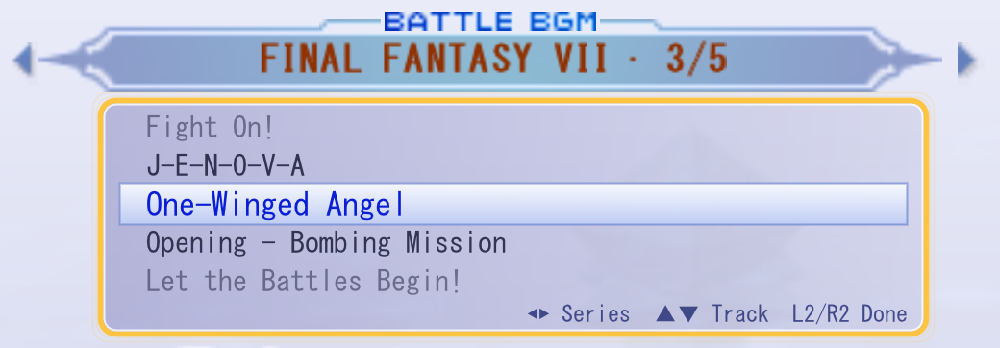
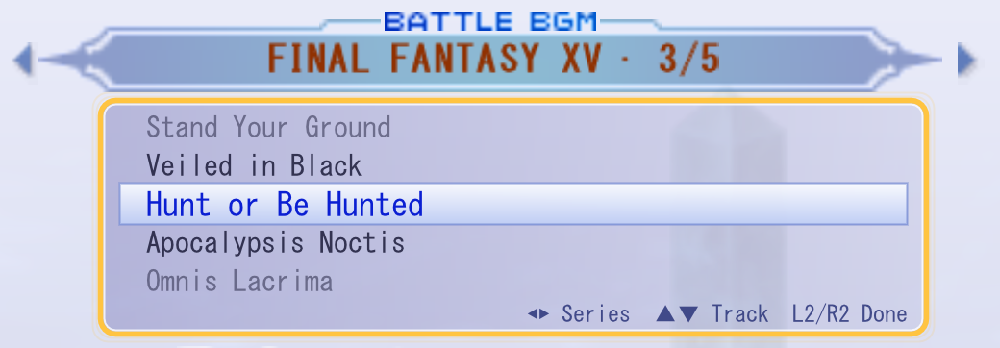
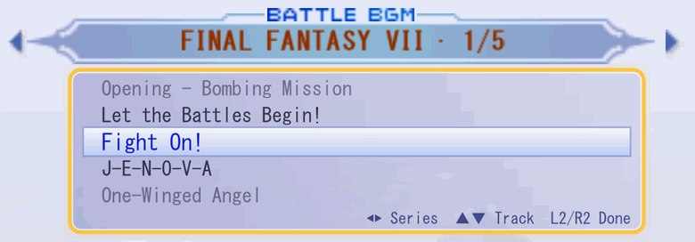
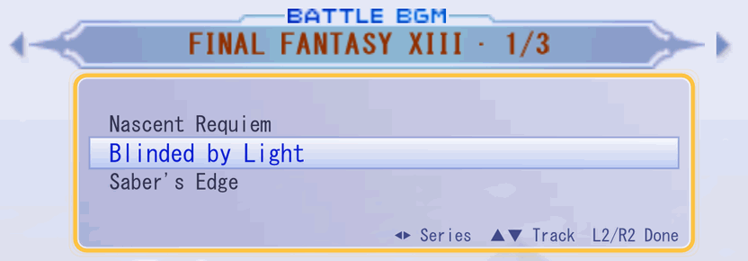

# Dissidia 012 Duodecim Final Fantasy: native PC port and decompilation

A native PC port of *Dissidia 012 Duodecim Final Fantasy* (PSP, USA release ULUS10566 v1.00), built by static
recompilation on [PortableKit](https://github.com/TeamGDB/PortableKit), together with a matching decompilation of the
game's executable and overlays.

- **The port** (`port/`) recompiles the game's MIPS code to C++ and runs it on PortableKit's re-implemented PSP
  kernel, system modules and Vulkan renderer. Decompiled C replaces recompiled functions where an enhancement needs
  it.
- **The matching decompilation** (`src/`, `include/`, `config/`, `tools/`) rebuilds the decrypted executable and all
  three overlays byte for byte with the original compilers, and is the reference for what the original code does.

**You need your own legally obtained copy of the game (USA ULUS10566); no game data is included or distributed.**

## Current state

- **Windows:** plays from New Game through the menus and battles in the recompiled build, with no interpreter
  fallbacks. Message, save-data and keyboard dialogs are drawn by the port. Expect rough edges; see the
  [bring-up log](docs/port/bring-up-log.md).
- **Linux and Steam Deck:** untested. PortableKit supports them, but this port has not been built or run there.
- **Matching decompilation:** a few hundred functions are matching C; most of the game is still machine code. See the
  [decompilation notes](docs/decomp/README.md) and the [progress report](docs/decomp/progress.md).

## Features

- **60 fps** display by frame interpolation over the game's 30 Hz logic.
- **Higher internal resolution.**
- **A mod folder** for content that adds to the game and never replaces it; the first kind is battle music in MP3,
  Ogg Vorbis, Opus, FLAC or WAV with loop points ([format](docs/port/mod-folder.md)).
- **A BGM playlist selector** on the loading screen: choose music by series and track, mod tracks included
  ([design](docs/port/bgm-playlist-design.md)).
- **A Battle BGM Maker**: a local browser tool for writing a mod's `mod.json` and setting its loop points
  ([README](port/tools/bgm_maker/README.md)).

## BGM playlist selector

The loading screen before a battle chooses its music by series and track. L2 or R2 (1 and 3 on the keyboard) moves
the D-pad from the screen's menu to the music: left and right change the series, up and down roll the track wheel,
and L2 or R2 again hands the D-pad back. Mods add series of their own after the game's
([design](docs/port/bgm-playlist-design.md), [mod format](docs/port/mod-folder.md)).

<p>
  
  
</p>

*Rolling through a series' tracks (up/down):*



*Switching series (left/right):*



The FINAL FANTASY XV and CRISIS CORE series in these captures come from a test mod with track titles only; it plays
generated tones.

## Requirements

- Windows 10 or 11 (x64) with a Vulkan-capable GPU.
- Visual Studio 2022 (C++ workload), CMake and Ninja.
- SDL3, glslang and the Vulkan headers and loader library; PortableKit's FFmpeg build is fetched on the first
  configure.
- Python 3.10 or newer, for the preparation, run and Battle BGM Maker scripts.
- A clone of PortableKit at `33800c4` with this repository's patches applied (`port/portablekit-patches/`).
- Your own dump of the game (USA ULUS10566 v1.00). The decrypted `EBOOT.ELF` and the overlays are produced locally
  from it.

The matching decompilation has its own toolchain (the historical PSP SNC compiler, a WSL build environment, splat,
spimdisasm and Ghidra with the Allegrex extension); see [getting started](docs/decomp/getting-started.md).

## Building

The full steps, from applying the PortableKit patches to the recompiled build and a first bounded run, are in
[`port/README.md`](port/README.md). In short:

1. Clone PortableKit into `tools/local/port/PortableKit`, check out `33800c4` on a branch `dissidia` and
   `git am port/portablekit-patches/*.patch`.
2. Place your ISO at the repository root and prepare the game directory with `tools/port/prepare_game_dir.py`.
3. Configure and build with `tools/port/pk_cmake.cmd` (Visual Studio environment), generate the recompiled corpora
   and build again.

## Repository layout

| Path | What it is |
| --- | --- |
| `port/` | The port: PortableKit profile and host code, decompiled C used as native overrides, PortableKit patches, example mod, Battle BGM Maker |
| `docs/port/` | Port research, bring-up log, recompiled build, mod folder and BGM playlist design |
| `tools/port/` | Port scripts: build wrapper, game-directory preparation, bounded runs, overlay metadata, surveys |
| `src/`, `include/` | Matching decompiled C/C++ for main and the menu, battle and extra overlays |
| `config/` | Build, linker, inventory and audit configuration for the matching builds |
| `tools/` | Build, verify, inventory, audit and analysis tools for the matching decompilation, and their tests |
| `docs/decomp/` | Matching-decompilation notes, milestones, audits and runtime validation |
| `docs/research/` | General research on the game's formats and systems (battle camera, movesets, pad module, roster and save) |

Ignored and never committed: the game image, everything extracted or built from it (`build/`, `orig/`, `asm/`,
`analysis/`, `assets/`), local toolchains and clones (`tools/local/`, `tools/compilers/`), and mods with music.

## Tests

```powershell
.\.venv\Scripts\python.exe -m unittest discover -s tools -p "test_*.py"
python -m unittest discover -s port/tools/bgm_maker/tests
```

Many tool tests need the locally extracted game files and skip or fail without them.

## Credits

- [PortableKit](https://github.com/TeamGDB/PortableKit) by TeamGDB (MIT): the recompiler, runtime, HLE and renderer
  the port is built on, with its bundled libraries (Dear ImGui, stb, xxHash, tiny-AES).
- [FFmpeg](https://ffmpeg.org/) (LGPL), as built by PortableKit, for movie and host audio decoding.
- [SDL3](https://libsdl.org/) (zlib licence), [glslang](https://github.com/KhronosGroup/glslang) (BSD-style) and
  the [Vulkan headers](https://github.com/KhronosGroup/Vulkan-Headers) (Apache 2.0 or MIT).
- PPSSPP was used as a behaviour reference only; none of its code is in this repository.

## Licence and disclaimer

Original code and documentation are under the [MIT licence](LICENSE). See [NOTICE.md](NOTICE.md) for what it does and
does not cover.

This project is not affiliated with or endorsed by Square Enix or Sony. *Dissidia*, *Final Fantasy*, PlayStation
Portable and all related names are trademarks of their respective owners.
