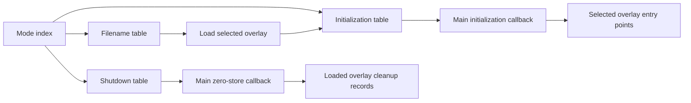

# Main overlay dispatch and missing entry points

Inventory revision 5, 11 October 2026. Tracing the main executable's overlay selection tables establishes the menu prefix's entry point and exposes **63 missing candidates / 5,072 function-body bytes** across main, menu and battle. Each addition has a checked call path; existing function boundaries are unchanged. The broader main/menu/battle maps remain provisional.

## File selection establishes the address namespace

Main `0x08933A80` indexes the filename table at `0x089D85C4`. Main `0x08933ACC` uses that helper to build a path, calls the ELF loader at `0x089331FC`, then indexes the initialization table at `0x089D85D0` with the same mode. Main `0x08933B4C` indexes the shutdown table at `0x089D85DC` before calling the descriptor cleanup walker through `0x0893335C`.

| Mode index | Selected file | Main initialization callback | Main shutdown callback |
| ---: | --- | --- | --- |
| 0 | `ovl_menu_app.elf` | `0x0887801C` | `0x0887974C` |
| 1 | `ovl_battle_app.elf` | `0x08878DE0` | `0x088798A0` |
| 2 | `ovl_extra_app.elf` | `0x088796AC` | `0x088799DC` |

These mode indices are separate from the overlay descriptor tags. The filenames and the actual indexing/call instructions establish each binding; no tag-to-index arithmetic is assumed.



Main `0x0887801C` calls address `0x089DD4D0` at `0x08878250`. Mode 0 has selected menu when this initialization callback runs, so the target is **`menu:0x089DD4D0`**. Extra already has a different function at that same address, and battle has another plausible prefix routine. Each binary keeps its own namespace.

## Menu prefix

The menu routine occupies **152 bytes**, `0x089DD4D0..0x089DD568`. It initializes parts of the supplied object using three main helpers, sets fields and data pointers, and returns the supplied pointer. Its final `jr ra` and stack-restoring delay slot precede the next existing menu function. Ghidra agrees with that contiguous extent after seeding the proven call target.

Its stores reference three numeric constant blocks in main at `0x089D8E70`, `0x089D8E88` and `0x089D8EA0`. The observed six-word blocks contain small integers. Their detailed type and meaning remain open; no extra callable entries were inferred from those data pointers.

## Other initialization roots and follow-up calls

The selected main initialization callbacks directly call **40 menu**, **29 battle** and **two extra** entry points. Thirteen menu targets and 21 battle targets were missing from the previous maps. The three main shutdown callbacks were missing as well, giving 37 newly seeded entries. Following their local calls recovers another **26 candidates**: two in menu and 24 in battle.

| Module | Previous candidates | Current candidates | Added candidates | Added function-body bytes |
| --- | ---: | ---: | ---: | ---: |
| Main | 8,617 | 8,620 | 3 | 676 |
| Menu | 6,277 | 6,292 | 15 | 756 |
| Battle | 6,198 | 6,243 | 45 | 3,640 |
| Extra | 100 | 100 | 0 | 0 |
| Total | 21,192 | **21,255** | **63** | **5,072** |

Fresh imports went into separate `dissidia-main-dispatch-v1`, `dissidia-menu-dispatch-v1` and `dissidia-battle-dispatch-v1` projects. The existing projects and annotations were preserved. Menu/battle imports include the previously established descriptor hooks before adding dispatch roots. Final inventories were exported read-only from the saved projects.

Actual MIPS `JAL` words in each module provide the follow-up call paths. The maintained maps record `dispatch_entry_review` for direct roots and `dispatch_reachability` for reached functions. All 63 additions are reached. Reachability supports their entries, while most body boundaries still have automatic confidence; this does not complete source or feature-ownership recovery.

The [metadata comparison](overlay-dispatch-changes.json) lists every addition, its body size, root and predecessor call. Preserved read-only exports from the previous projects provide the baseline. The comparison rejects removed functions or changes to existing ranges, and excludes the 34 ELF-import reconciliations that predate this review.

## Shutdown routines

The three missing main callbacks are independent leaf functions:

| Active module | Function | Bytes | Words cleared |
| --- | --- | ---: | ---: |
| Menu | `main:0x0887974C` | 340 | 42 |
| Battle | `main:0x088798A0` | 316 | 39 |
| Extra | `main:0x088799DC` | 20 | 2 |

Each consists of absolute-address `lui` / `sw zero` pairs, with a final `jr ra` followed by the last store in its delay slot. The validator checks the entire body, not just the return or first pair, and records all **83 cleared word addresses**. Original variable names and types remain unknown. The words include globals belonging to the currently loaded overlay, so this cleanup occurs before that overlay is replaced.

These callbacks are separate from the overlay descriptor's initializer/cleanup hook arrays. Both lifecycle mechanisms are now represented in the maintained metadata.

## Progress and validation

The function-body union now totals **4,716,320 bytes**. Unknown executable-section bytes decrease by **4,872**, to **236,992**: main 49,040, menu 116,152 and battle 71,800. The byte change differs from the added function bytes because some bodies were already decoded and further reachable instructions were decoded outside function bodies. No overlapping function bodies are present.

Matching recovery remains **24 C functions / 2,116 bytes**, all in extra, which remains **9.28% matching by reviewed code bytes**. The existing extra build still passes the full-file retail comparison. The other module maps, whole-game audited percentage and feature denominators remain unfinished.

All **54 inventory, matching and progress checks pass**. New negative cases reject filename aliasing, a dropped mode, initialization using the shutdown table, bypassing the loader, a shutdown store of a nonzero argument, resolving a missing menu entry from another overlay, and a follow-up callee without its actual local call.

## Reproduce

The seed manifest is metadata-only `config/overlay-dispatch.json`. Refresh it from the pinned main reference and function ranges:

```powershell
.\.venv\Scripts\python.exe tools/prepare_dispatch_entries.py
```

To create the projects on a fresh workspace, use fresh names:

```powershell
.\tools\run_inventory.ps1 -Module main -ProjectName dissidia-main-dispatch-v1 -SeedReviewedEntries
.\tools\run_inventory.ps1 -Module menu -ProjectName dissidia-menu-dispatch-v1 -SeedOverlayHooks -SeedReviewedEntries
.\tools\run_inventory.ps1 -Module battle -ProjectName dissidia-battle-dispatch-v1 -SeedOverlayHooks -SeedReviewedEntries
```

Seeding an existing project is refused. To refresh the projects already created here:

```powershell
.\tools\run_inventory.ps1 -Module main -ProjectName dissidia-main-dispatch-v1
.\tools\run_inventory.ps1 -Module menu -ProjectName dissidia-menu-dispatch-v1
.\tools\run_inventory.ps1 -Module battle -ProjectName dissidia-battle-dispatch-v1
.\tools\run_inventory.ps1 -Module extra
.\.venv\Scripts\python.exe tools/build_inventory.py
.\.venv\Scripts\python.exe tools/report_dispatch_changes.py
.\.venv\Scripts\python.exe tools/progress.py
.\.venv\Scripts\python.exe -m unittest discover -s tools -p 'test_*.py'
```

Close the selected Ghidra project in the GUI before headless exports. The comparison baseline is reproduced with `-SnapshotName dispatch-baseline-v4`, using `dissidia-main`, `dissidia-menu-hooks-v1` and `dissidia-battle-hooks-v1`. Snapshot exports have separate output directories and preserve current raw inventories. The main input, overlays, disassembly and Ghidra projects remain local and ignored by Git.

Revision 6 completes the [deferred battle path](deferred-battle-audit.md): callback registration/member dispatch and an explicit battle-mode barrier establish the prefix entry. The subsequent [battle build milestone](battle-build-milestone.md) integrates ten matching C functions into a byte-identical full overlay. These reports supersede this revision 5 snapshot's totals and pending-work statement. Data-gap audits and the menu/main build foundations remain next.
