# Playing online

Players, each with their own copy of the port, fight over the internet in the game's own **Communications Mode**:
1-on-1 battles in the Online Lobby, Group Battle's party battles with watching, and trading Friend Cards and quests.
Windows, Linux (Steam Deck) and Android copies play each other. **Experimental:** the details may change. How it
works: [Communication Mode](communication-mode.md) and [online matchmaking](online-matchmaking.md).

There are three ways to go online:
- **Play Online**: through the game's server. Nothing to set up and no address to send: everyone on the same release
  meets in the game's lobbies.
- **Host a Session**: a private session for friends. Your game runs it and the others join it.
- **Join a Session**: join a friend's session, on your network or by the address they send you.

Both players need the same release of the port, the same mods that change the game (music mods may differ) and the
same test settings. The game checks as a battle starts and says what differs. Saves and official DLC may differ.

To find someone to play, ask on the [Discord server](https://discord.gg/9GrbdQwPbS). Send an address by direct
message, not in a public channel. The pictures use example addresses; yours are your own.

## Choosing how to play

The first time the game goes online (**Communications Mode**, then **Online Lobby**, **Group Battle** or
**Communications**), it asks how you want to play:

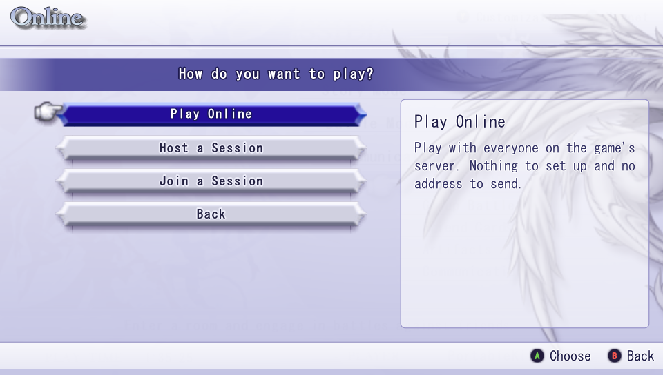

- **Play Online** says how many players are on now. Choose it and the game goes on to its lobbies.
- **Host a Session** starts hosting and shows your internet address, already copied for you to send.
- **Join a Session** lists the sessions on your network and the ones you joined before, and **Enter an Address**
  types a new one.
- **Back** stays offline and returns to the menu.

Play Online is remembered: the game goes straight online next time. A session hosted or joined lasts until the game
closes. Friend Cards and Artifacts work offline and do not ask.

The same choices are on the port's **Network** page (open the menu with Esc, or L3 + R3 together on a controller, then
LB or RB, or Q or W, until it shows). Playing online, the page says how many players are on and offers **Stop playing
online**; a joined session has **Leave the session**, and hosting **Stop hosting**. Each leaves nothing chosen, so the
game asks again.

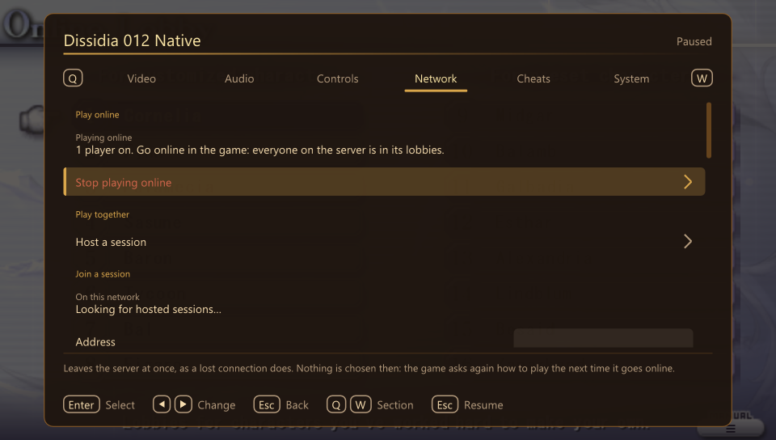

## Play Online

1. Choose **Play Online** when the game asks, or on the Network page.
2. Everyone playing online on your release shares the game's 16 lobbies. Agree on one with the other player, for
   example on Discord, or find a busy one.
3. Challenge as in [Then, in the game](#then-in-the-game).

In **Group Battle**, Search for a Room lists every open room on the server. In **Communications**, everyone online
in it at the same moment trades with you, strangers too.

## Host a session

1. Choose **Host a Session** when the game asks, or open the port's menu, go to the **Network** page and select
   **Host a session**.

   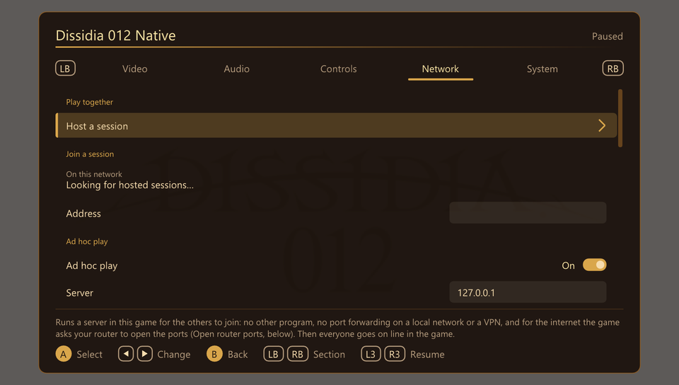

2. The game asks your router to open its ports. After a moment the rows under Play together show your addresses:
   - **Local network**: for a player on the same network as you. They need not type it: your session appears in
     their Join a session list by itself.
   - **Internet (NAT-PMP)** or **Internet (UPnP)**: for a player anywhere else. Select it and the address is copied
     (it shows under **Copied**); paste it into a message to the other player.

   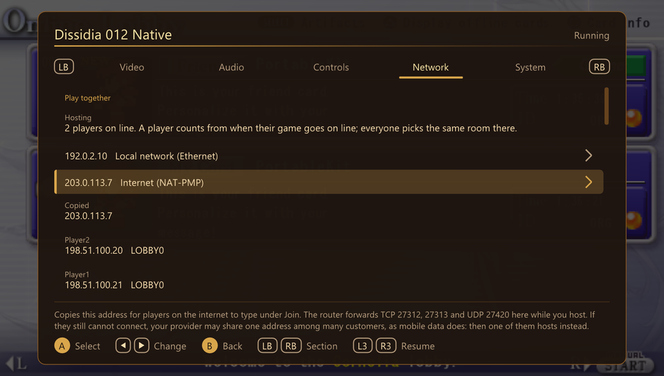

3. The first time, Windows may ask whether to let the game use the network: allow it on private networks.
4. The session runs until the game closes; **Stop hosting** ends it.

**Hosting** shows how many players are online in the game, you included, and lists them with the lobby each is in,
named as the game names it (Lobby 1 Cornelia). If the internet row says the router did not open the ports, or that
your provider shares the address, see [If something goes wrong](#if-something-goes-wrong), or play online instead.

## Join a session

1. Choose **Join a Session** when the game asks, or open the **Network** page.
2. **On the same network as the host:** their session is listed with their name and address. Select it.
3. **Anywhere else:** choose **Enter an Address** (on the Network page, **Address**). Type the address the host sent
   you, with a keyboard or the on-screen keys, and confirm with **OK** (Start on a controller, Enter on a keyboard).

   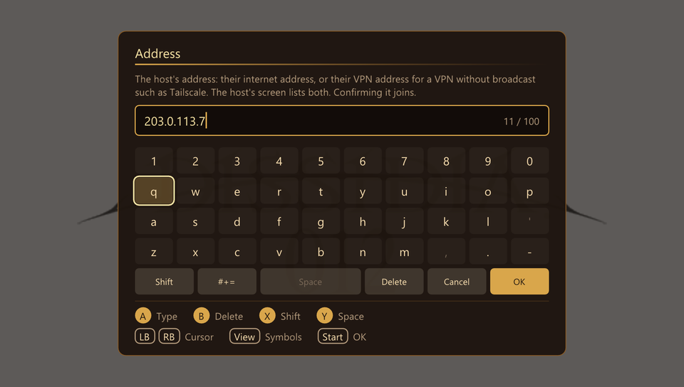

4. **Joined** shows the host's address: the game connects when it goes online. Addresses you join are kept, so next
   time one press joins again.

   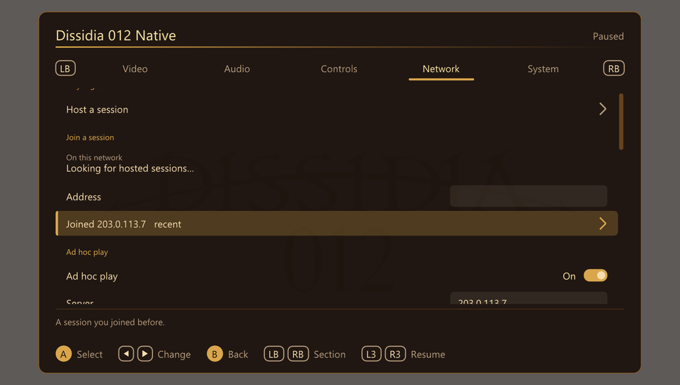

## Then, in the game

Both players do the same from here.

1. On the main menu, choose **Communications Mode**, then **Online Lobby**.
2. Both pick **the same lobby**, for example 1 Cornelia. Lobbies 1 to 8 are for customised characters, 9 to 16 for
   preset ones.

   

     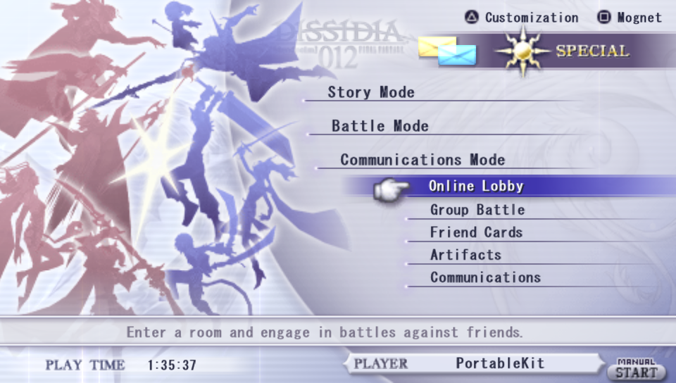
     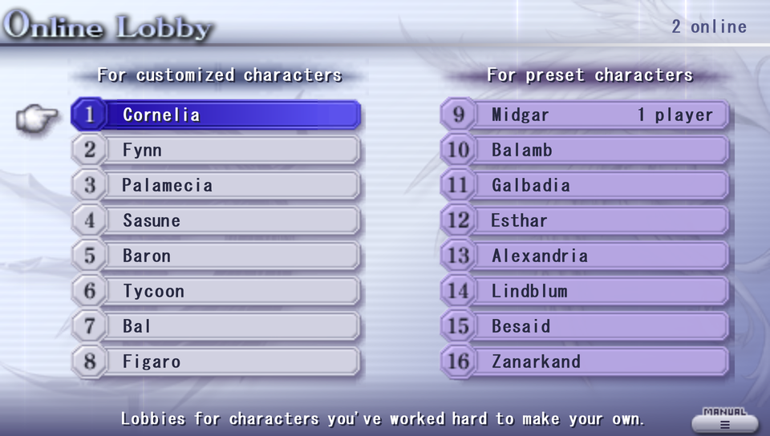
   

3. In the lobby the other player's Friend Card appears, marked **Online**. One player selects it and chooses
   **Battle Request [1-on-1]**. The other is told "You've been challenged to an online match!" and answers **YES**
   to accept.

   

     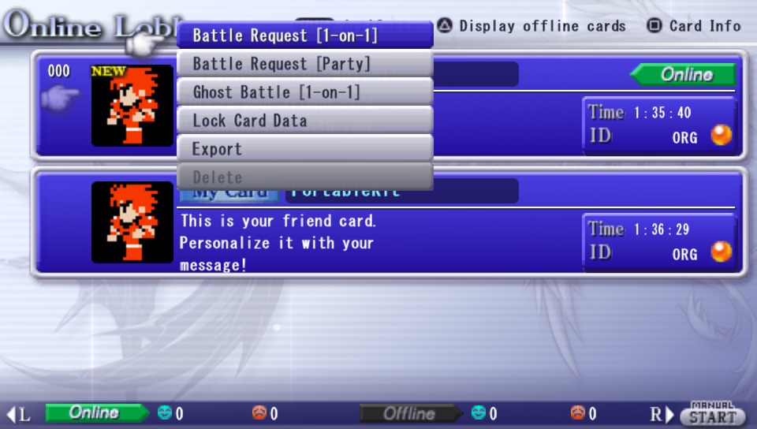
     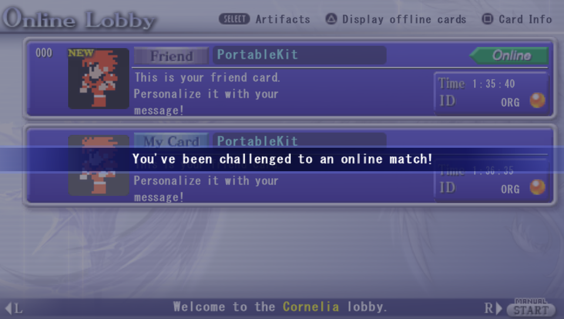
   

4. Both pick a fighter. The game gives one player the **HOST** badge (not necessarily the one who hosts a session):
   that player sets the stage and rules and selects **Enter Battle**.

   

     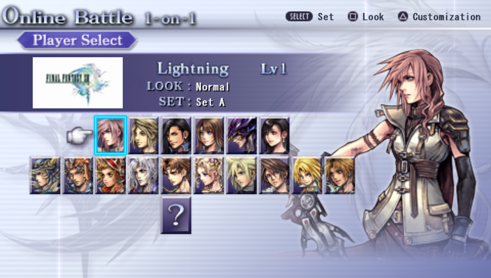
     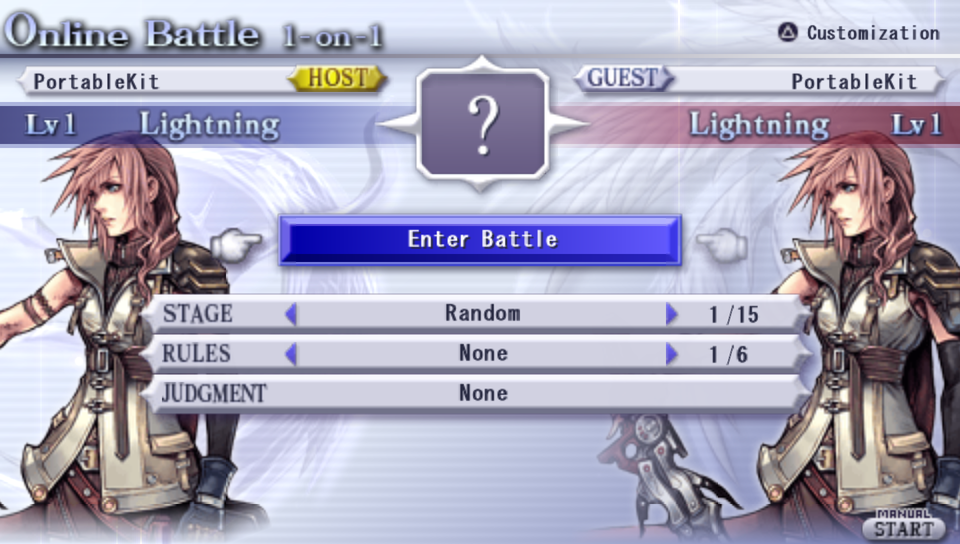
   

After the battle, both are back at the battle setup, where Enter Battle starts a rematch.

## During a battle

**The battle's path.** A battle goes straight between the two players' games when they can reach each other, and
through the server (or the host's game) when they cannot. If the straight path stops working, the battle moves to
the server and goes on.

**Always through the server** (Network page, Online battles): every battle goes through the server, so the other
player's game never learns your internet address. It may add a frame of input delay.

**Rollback.** Through Play online, each game runs up to 7 frames ahead of the other player's input, guessing it,
and corrects itself when the guess was wrong, so a slow moment on the connection does not stop the battle. In a
hosted or joined session each frame waits for both players' input. `online.rollback` in `settings.ini` (in the data
folder) changes it: `off`, or 1 to 12 frames.

**Input delay** (Network page, Online battles): the frames between pressing a button and the fighter acting. When
the two players' settings differ, the higher counts. **Auto**, the default, sets it from the connection as the battle
starts: 2 frames up to a round trip of about 100 ms, more when it is longer, and less with rollback. A fixed number
smooths a poor connection (higher) or responds sooner (lower).

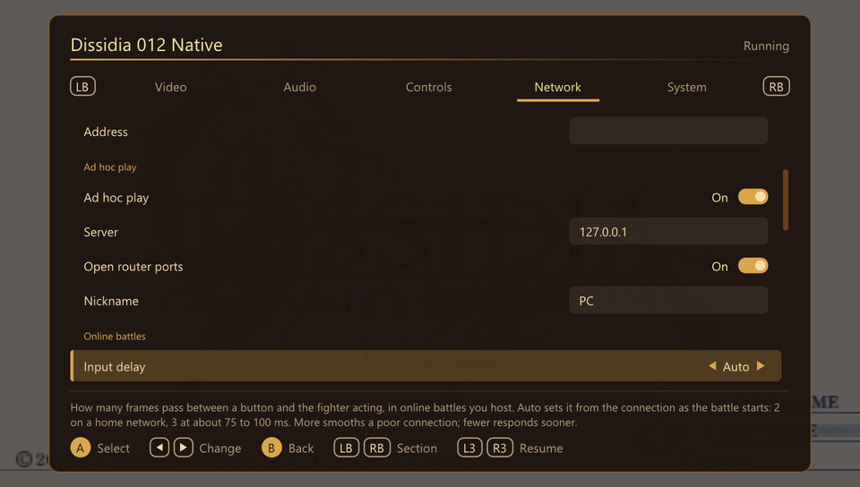

**Waiting.** If the other player's game falls silent, a band says "Waiting for the other player" and counts the
seconds. Hold B (or Esc) to leave the battle: the bar along the band's foot fills, and the battle ends when it is full.
After 30 seconds the game gives up by itself.

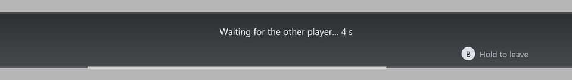

**Each player keeps their own camera settings.** The right-stick camera's dead zone, sensitivity and inverted axes
are sent across, so the other game turns your camera the way you set it.

## Group Battle

Everyone plays online, or hosts or joins one session. Then one player chooses **Communications Mode**, **Group
Battle**, **Create Room**, and the others **Search for a Room** and enter it. The room's creator starts the Group
Battle; each player picks Party A, Party B, or **Watch match** (SELECT). The creator picks the format, each fighter
sets a character on their slot, and both parties press **Enter Battle**.

Players who are not fighting watch each fight a moment behind the fighters: under half a second on a good
connection, up to a second and a half on a poor one. Their own controls do nothing in the fight. If the fight stops
coming, a band says "Waiting for the fighters"; holding B (or Esc) stops watching, which ends the battle for that
player. A player who falls behind jumps ahead to catch up.

## Trade Friend Cards and quests

Everyone plays online, or hosts or joins one session. Then, in the game:

1. Choose **Communications Mode**, then **Communications**, then **Send Friend Card** or **Send Original Quest**.
2. Read the two notes about sleep mode (the port does not sleep) and answer **YES** to "Begin player exchange?".
3. Each game shows "Receiving data from 1 players" once another player is there too. Everyone in Communications at
   that moment trades with everyone else, up to 16 players.
4. Press circle to stop, and **NO** to "Continue data transfer?". The game lists the cards and quests that came;
   new Friend Cards are in **Friend Cards**, marked NEW.

## What the server sees

- **The game's server** sees each player's internet address, nickname, the game's ID (the MAC on the Network page)
  and its release. Its log keeps them for a week, to turn away players who cause trouble. There are no accounts and
  no passwords.
- **In a battle that goes straight between two games**, each game learns the other's internet address and its
  address on its home network, as everyone in a hosted session learns the host's. **Always through the server**
  keeps them hidden.
- **Communications on the server** trades Friend Cards and quests with everyone there at the same moment, strangers
  included.

How to run a server of your own: [Running a server](run-a-server.md). To use one, type its address in **Online
server** on the Network page (under Ad hoc play); Play Online then goes there.

## If something goes wrong

**Play Online is dimmed and says the server's address could not be fetched.** The game reads the server's address
from this project's GitHub when it first goes online. Check the internet connection, or host or join a session
instead. **There is no public server yet** means the release has none.

**A challenge ends with "The challenge was canceled".** Send it again.

**You see each other on the Network page but not in the game.** Pick the same lobby. In a session, only one player
hosts; the others join. The host's list shows the lobby each player is in, and says so when everyone is in a
different one. If it says a player is **not seen by the others**, their game reaches TCP 27312 but not 27313, which
carries everything in a lobby: open both, as below. That player's own game says the same at the top of the screen.

**Sending a report.** On the Network page, under Troubleshooting, **Save network log** writes a file with what this
game could reach, and on the host who reached which port and lobby. The page shows where it saved it. Send both
players' files with the report. **Log every call and packet**, just above it, puts every detail of the network in
that log while it is on.

**"This battle cannot start: the other player's game differs in ..."** The two games are not the same: update both
to the same release, and use the same mods that change the game. The notice names what differs; here, one player had
turned analog walking in battle on:

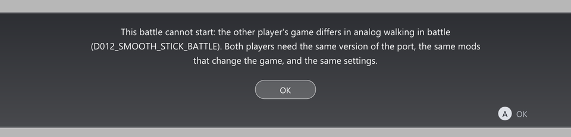

**"The other player's game did not answer."** In a session, the battle's UDP port does not get through to the host.
See the next paragraphs, or play online instead.

**The row says the router did not open the ports.** Turn on UPnP or NAT-PMP in the router's settings, or forward
these ports on the router to the host's local address, which the Network page lists:

| Port | For |
| --- | --- |
| TCP 27312 | The lobby |
| TCP 27313 | The lobby's relay |
| UDP 27420 | The battle |

Then turn off **Open router ports** on the Network page, so the game stops asking.

**The row says your provider shares the address.** Your router has no address of its own on the internet: your
provider shares one among many customers (carrier-grade NAT, the rule on mobile data and common on some home
connections), or another router sits in front of yours. Opening ports does nothing then. Play online, let the other
player host, or both use a VPN.

**A VPN** puts both players on one private network, so no router is involved:
[Tailscale](https://tailscale.com/) or [ZeroTier](https://www.zerotier.com/). Both players install it and join the
same network. The host hosts as above; the joiner types the host's VPN address, which the host's Network page lists
too (Tailscale's start with `100.`).

**Something else blocks it.** A firewall program other than Windows' own needs the same three ports allowed.

## Not tested yet

- Players on the game's server from far apart, and a router that does not let two games reach each other straight
  (the battle then goes through the server).
- More than one player watching at once (a Steam Deck and two PC copies played Tournaments and a Round-Robin,
  one watcher at a time).
- Sending an Original Quest, and Import a Friend Card (Friend Cards were traded between Windows and a Steam Deck).
- Two Windows PCs on separate machines (Windows against a Steam Deck and a phone, and two copies on one PC, were).
- A router that only has UPnP (the one tested answered NAT-PMP first).
