# Playing online

Two players, each with their own copy of the port, fight a 1-on-1 battle over the internet through the game's
Communications Mode. **Experimental:** it has been played between Windows and a Steam Deck, and
between Windows and Linux, and the details may change. How it works and how it was tested:
[Communication Mode](communication-mode.md), sections 11 to 16.

Both players need the same version of the port, the same mods that change the game (music mods may differ) and the
same test settings. The game checks as the battle starts and says what differs. Saves and official DLC may differ.

The Online Lobby's 1-on-1 battles, Group Battle's party battles and Communications (trading Friend Cards and quests)
work online. In Group Battle, players who are not fighting watch the fight as the fighters play it.

One player **hosts** a session and the other **joins** it, both on the port's Network page. Then both go online in
the game as they would on a PSP. The host should be the player on a home connection: mobile data cannot host (see
[If something goes wrong](#if-something-goes-wrong)).

To find someone to play, ask on the [Discord server](https://discord.gg/9GrbdQwPbS). Send your address by direct
message, not in a public channel.

The pictures use example addresses; yours are your own.

## Host

1. Open the port's menu: Esc, or L3 + R3 together on a controller. Press LB or RB (Q or W on a keyboard) until the
   **Network** page shows.
2. Select **Host a session**, the first row. It also turns on **Ad hoc play** further down the page, the game's
   wireless switch; joining does the same.

   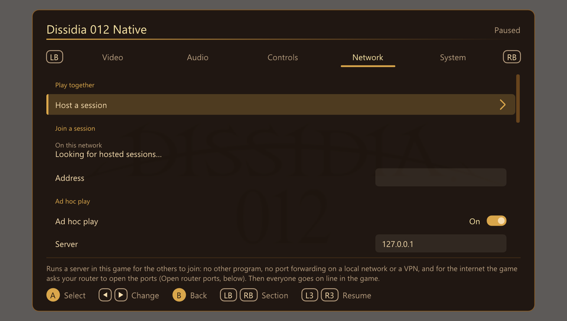

3. The game asks your router to open its ports. After a moment the rows under Play together show your addresses:
   - **Local network**: for a player on the same network as you. They need not type it: your session appears in
     their Join a session list by itself.
   - **Internet (NAT-PMP)** or **Internet (UPnP)**: for a player anywhere else. Select it and the address is copied
     (it shows under **Copied**); paste it into a message to the other player.

   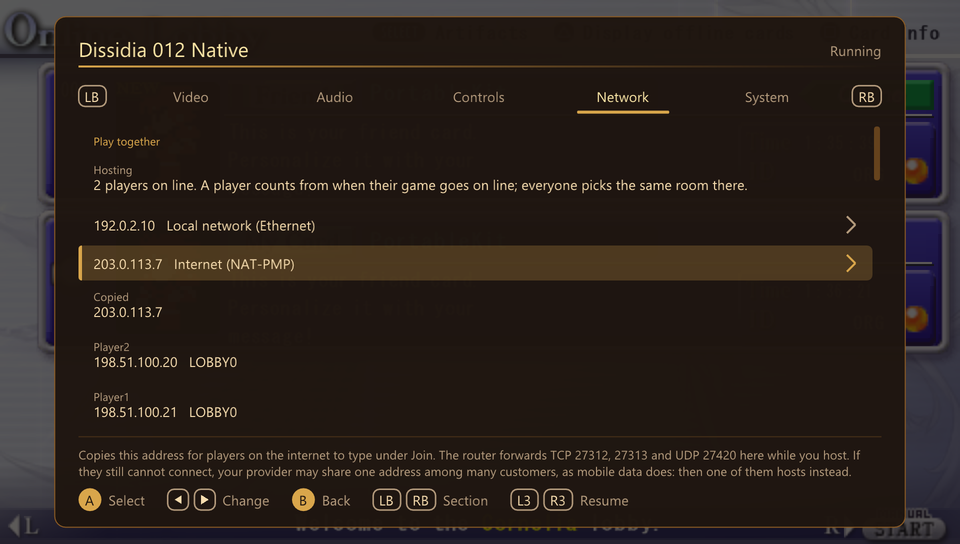

4. The first time, Windows may ask whether to let the game use the network: allow it on private networks.
5. Close the menu (B, Esc, or L3 + R3 again). The session runs as long as the game does; **Stop hosting**, further
   down the same rows, ends it.

**Hosting** shows how many players are online in the game, you included, and lists them with the lobby each is in,
named as the game names it (Lobby 1 Cornelia). If the internet row says
the router did not open the ports, or that your provider shares the address, see
[If something goes wrong](#if-something-goes-wrong).

## Join

1. Open the port's menu and go to the **Network** page, as the host did.
2. **On the same network as the host:** their session is listed under Join a session as **Join** with their name and
   address. Select it, and skip to step 4.
3. **Anywhere else:** select **Address**. Type the address the host sent you, with a keyboard or the on-screen keys,
   and confirm with **OK** (Start on a controller, Enter on a keyboard).

   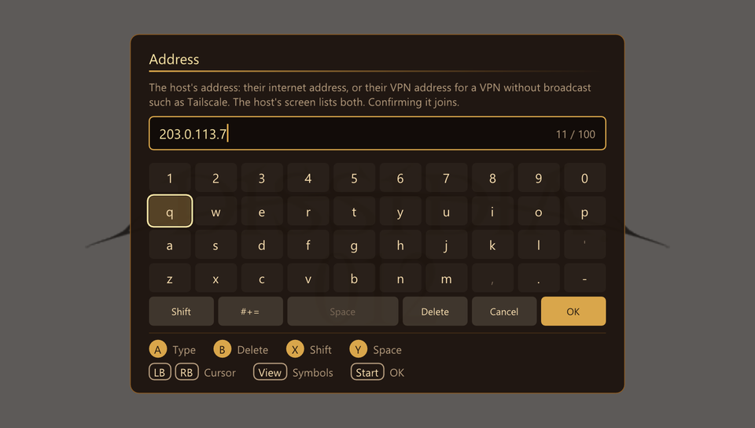

4. **Joined** shows the host's address: the game connects when you go online. Every address you join is kept
   under Join, so next time one press joins again.

   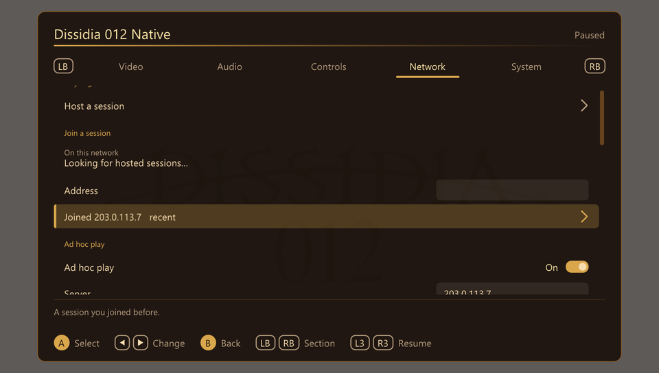

5. Close the menu.

## Then, in the game

Both players do the same from here.

1. On the main menu, choose **Communications Mode**, then **Online Lobby**. The game goes online through the
   session.
2. Both pick **the same lobby**, for example 1 Cornelia. Lobbies 1 to 8 are for customised characters, 9 to 16 for
   preset ones.

   

     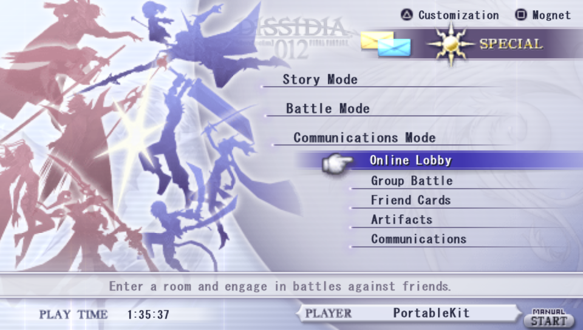
     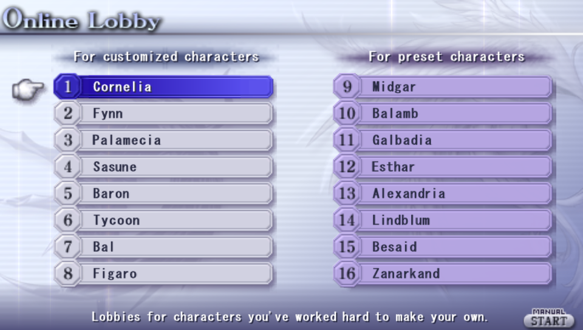
   

3. In the lobby the other player's Friend Card appears, marked **Online**. One player selects it and chooses
   **Battle Request [1-on-1]**. The other is told "You've been challenged to an online match!" and answers **YES**
   to accept.

   

     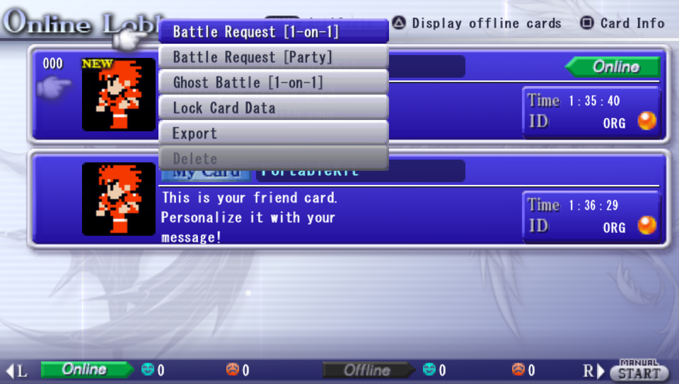
     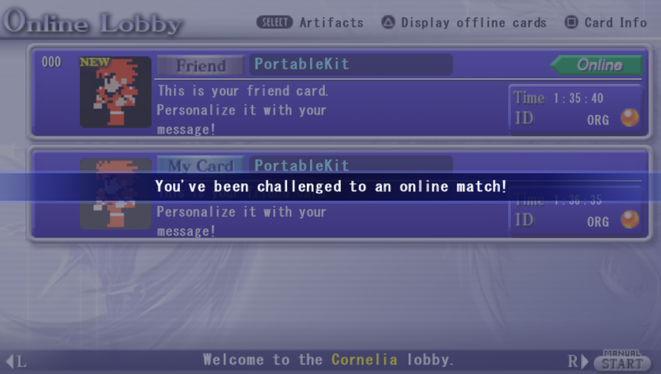
   

4. Both pick a fighter. The game gives one player the **HOST** badge (not necessarily the one who hosts the
   session): that player sets the stage and rules and selects **Enter Battle**.

   

     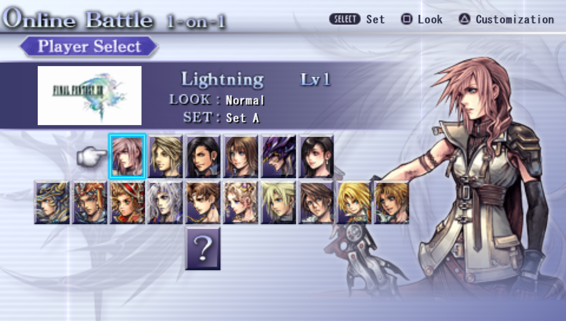
     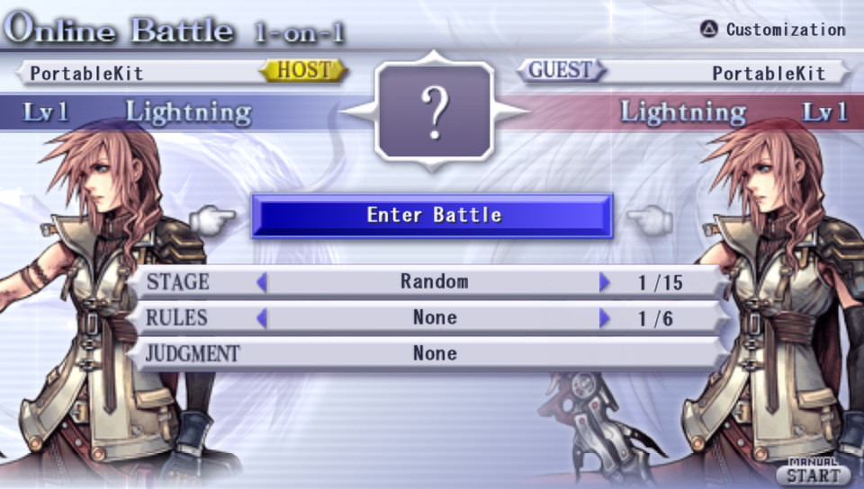
   

The battle then finds its own way to the other player. After it, both are back at the battle setup, where Enter
Battle starts a rematch.

## During a battle

**Input delay** (Network page, Online battles): the frames between pressing a button and the fighter acting. When
the two players' settings differ, the higher counts. **Auto**, the default, sets it from the connection as the battle starts: 2 frames up to a
round trip of about 100 ms, more when it is longer. A fixed number smooths a poor connection
(higher) or responds sooner (lower).

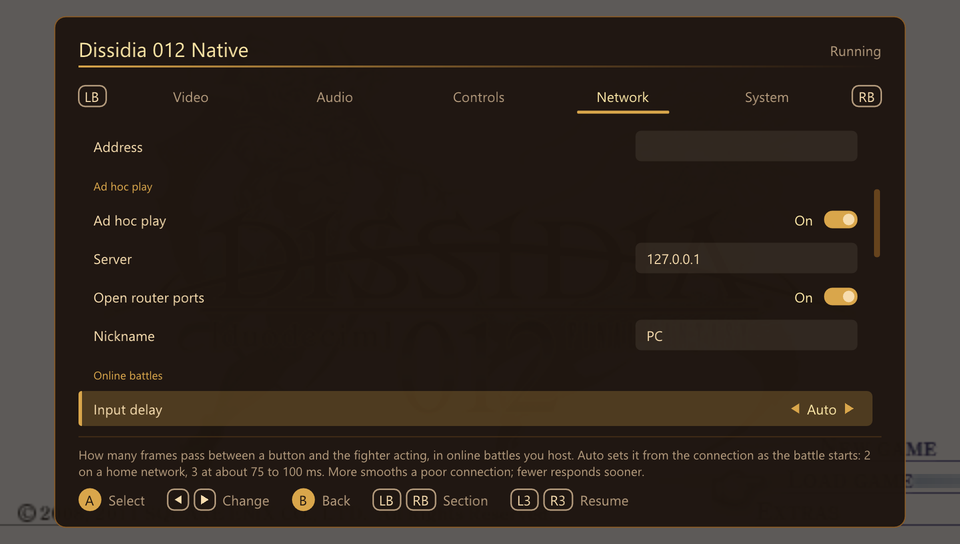

**Waiting.** If the other player's game falls silent, a band says "Waiting for the other player" and counts the
seconds. Hold B (or Esc) to leave the battle: the bar along the band's foot fills, and the battle ends when it is full.
After 30 seconds the game gives up by itself.

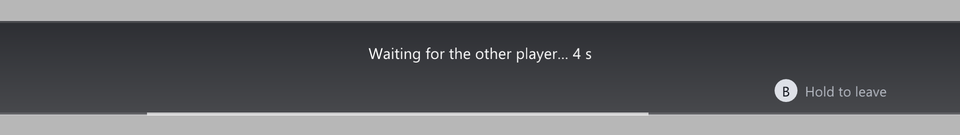

**Each player keeps their own camera settings.** The right-stick camera's dead zone, sensitivity and inverted axes
are sent across, so the other game turns your camera the way you set it.

## Group Battle

Everyone hosts or joins one session as above. Then one player chooses **Communications Mode**, **Group Battle**,
**Create Room**, and the others **Search for a Room** and enter it. The room's creator starts the Group Battle; each
player picks Party A, Party B, or **Watch match** (SELECT). The creator picks the format, each fighter sets a
character on their slot, and both parties press **Enter Battle**. Anyone in the session can host the session, fighting
or not.

Players who are not fighting watch each fight a moment behind the fighters: under half a second on a good
connection, up to a second and a half on a poor one. Their own controls do nothing in the fight. If the fight stops
coming, a band says "Waiting for the fighters"; holding B (or Esc) stops watching, which ends the battle for that
player. A player who falls behind jumps ahead to catch up.

## Trade Friend Cards and quests

Both players host or join a session as above. Then, in the game:

1. Choose **Communications Mode**, then **Communications**, then **Send Friend Card** or **Send Original Quest**.
2. Read the two notes about sleep mode (the PC does not sleep) and answer **YES** to "Begin player exchange?".
3. Each game shows "Receiving data from 1 players" once the other is there too. Everyone in the session with
   Communications open trades with everyone else, up to 16 players.
4. Press circle to stop, and **NO** to "Continue data transfer?". The game lists the cards and quests that came;
   new Friend Cards are in **Friend Cards**, marked NEW.

## If something goes wrong

**You see each other on the Network page but not in the game.** Only one player selects Host a session; the other
selects Join. Then both pick the same lobby. The host's list shows the lobby each player is in, and says so when
everyone is in a different one. If it says a player is **not seen by the others**, their game reaches TCP 27312 but not
27313, which carries everything in a lobby: open both, as below. That player's own game says the same at the top of
the screen.

**Sending a report.** On the Network page, under Troubleshooting, **Save network log** writes a file with what this
game could reach, and on the host who reached which port and lobby. The page shows where it saved it. Send both
players' files with the report.

**"This battle cannot start: the other player's game differs in ..."** The two games are not the same: update both
to the same release, and use the same mods that change the game. The notice names what differs; here, one player had
turned analog walking in battle on:

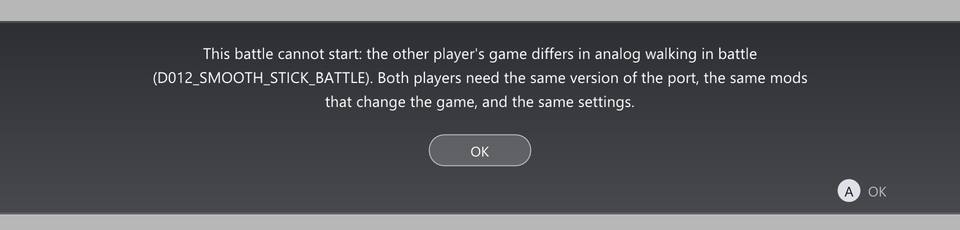

**"The other player's game did not answer."** The battle's UDP port does not get through to the host. See the next
paragraphs.

**The row says the router did not open the ports.** Turn on UPnP or NAT-PMP in the router's settings, or forward
these ports on the router to the host's local address, which the Network page lists:

| Port | For |
| --- | --- |
| TCP 27312 | The lobby |
| TCP 27313 | The lobby's relay |
| UDP 27420 | The battle |

Then turn off **Open router ports** on the Network page, so the game stops asking.

**The row says your provider shares the address.** Your router has no address of its own on the internet: your
provider shares one among many customers (carrier-grade NAT, the rule on mobile data and common on some home
connections), or another router sits in front of yours. Opening ports does nothing then. The other player hosts
instead, or you both use a VPN.

**A VPN** puts both PCs on one private network, so no router is involved:
[Tailscale](https://tailscale.com/) or [ZeroTier](https://www.zerotier.com/). Both players install it and join the
same network. The host hosts as above; the joiner types the host's VPN address, which the host's Network page lists
too (Tailscale's start with `100.`).

**Something else blocks it.** A firewall program on the host other than Windows' own needs the same three ports
allowed.

## Not tested yet

- More than one player watching at once, and party battles of more than one fight between machines (a Steam
  Deck and two PC copies were, one fight each).
- Sending an Original Quest, and Import a Friend Card (Friend Cards were traded between Windows and a Steam Deck).
- Two Windows PCs on separate machines (Windows against the Steam Deck, and two copies on one PC, were).
- A router that only has UPnP (the one tested answered NAT-PMP first).
